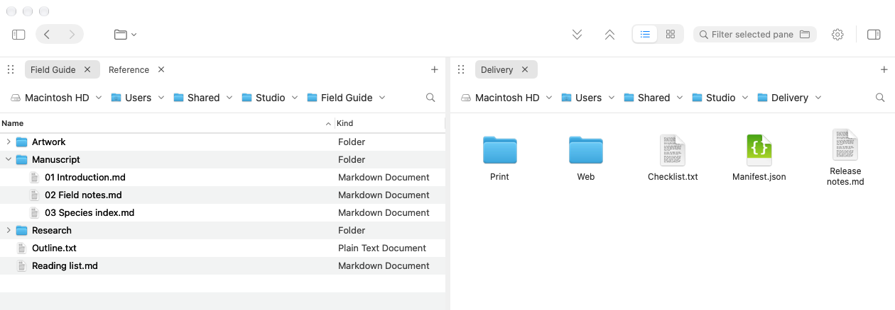

# Filetor Pro

**English** · [简体中文](README.zh-CN.md)

Filetor Pro is a native macOS file manager for working in several folders at once. Keep source files in one pane and a destination in another, expand a folder without losing your place, and press Space to see what’s inside a file or ZIP archive. The interface is built with SwiftUI and AppKit.

**[Download for Apple Silicon](https://github.com/Doithoo/Filetor-Pro/releases/latest)** · [Release notes](https://github.com/Doithoo/Filetor-Pro/releases) · [Report an issue](https://github.com/Doithoo/Filetor-Pro/issues)



## Install on macOS

The published app requires **macOS 26 or later** and a **Mac with Apple silicon**. There is no Intel download. The interface and built-in help are available in English and Simplified Chinese.

1. Open the [latest release](https://github.com/Doithoo/Filetor-Pro/releases/latest). Under **Assets**, download `Filetor-Pro-<version>-arm64.zip`. The *Source code* archives do not contain the app.
2. Unzip the download, move **Filetor Pro.app** to **Applications**, then open it from there.
3. If macOS blocks the first launch, see [First launch and folder access](#first-launch-and-folder-access). To change the interface language, open **Settings → General → Interface language**, choose a language, then quit and reopen the app.

For subsequent releases, choose **Filetor Pro → Check for Updates…**, or enable **Settings → Updates → Automatically check for and install updates**. Sparkle verifies the signed update feed and download. Automatic updates install when you quit; you don’t have to replace the app by hand.

## Try a two-pane workflow

| What you want to do | How to do it |
| --- | --- |
| See a folder and its contents together | In **List View**, click the triangle beside a folder. Use **View → Expand All Folders** to open the tree in the active pane. |
| Put another folder alongside it | Right-click empty space and choose **Split Vertically (Left / Right)**. Choose **Split Horizontally (Top / Bottom)** to stack panes instead. Each pane has its own tabs. |
| Rearrange your workspace | Drag the grip at the start of a tab bar. Drop in another pane’s center to swap, or at its edge to move there. Closing a pane’s last tab closes that pane. |
| Go to a path or find a file | Click the blank area of the path bar to edit the full path; Tab completes a suggestion. The magnifying glass searches by name, kind, extension, date and size, optionally including subfolders. |
| Inspect an item without opening it | Select it and press **Space**. Press Space again to close. For details that stay visible as you browse, use the information panel button at the right edge of the toolbar. |

A window supports up to 16 panes. Tabs, folder locations and split proportions restore across launches. Open a separate window with **⌘N** or another tab in the current pane with **⌘T**.

## File operations and format support

| Tool | What it does |
| --- | --- |
| Organize files | Copy, cut, paste, move to a chosen folder, batch rename or create a text file from the context menu. The sidebar provides favorites, mounted volumes, Finder tags and Trash. |
| Compare and synchronize | Compare visible regular files by relative path, size and modification date. Review the proposed copy direction before syncing; a two-way sync is one undo step. Hidden files, package contents and empty folders are excluded. This is not a content-verified backup. |
| Preview | Built-in previews cover folders, ZIP listings, common text and source files, Markdown, JSON and property lists. Images, PDFs and other supported media use macOS Quick Look. A ZIP preview lists entries without extracting them. |
| Compress and extract | Create ZIPs. Extract ZIP, TAR, gzip/bzip2/xz-compressed TARs, and individual gzip or bzip2 files. For 7z, RAR, encrypted or split archives, use **Open With** to choose a compatible installed app, or **Other…** to select one manually. |

For more tools, including duplicate detection, saved searches and image conversion, open **Help → Filetor Pro Help**. The guide and keyboard shortcut reference work offline.

## First launch and folder access

**macOS blocked the app.** Published builds use the maintainer’s persistent signing certificate; they are not Developer ID signed or notarized by Apple. If you downloaded the release from this repository and trust it, try opening it once, then look for **Open Anyway** in **System Settings → Privacy & Security**. There is no need to disable Gatekeeper.

**Trash or a protected folder won’t open.** In **Filetor Pro → Settings → Folder Access**, use **Reveal Current App** to identify the installed copy. If the location requires Full Disk Access, add that copy in **System Settings → Privacy & Security → Full Disk Access**, then quit and reopen Filetor Pro. macOS controls these permissions.

File operations run locally. Update checks contact GitHub; the updater does not upload file contents or send a system profile. **Help → Report an Issue…** opens an editable GitHub draft with app and macOS versions. Nothing is submitted until you send it.

## Build from source

On a Mac with Python 3, a Swift toolchain and a compatible macOS SDK, run:

```sh
git clone https://github.com/Doithoo/Filetor-Pro.git
cd Filetor-Pro
FILETOR_ADHOC_BUILD=1 python3 scripts/build.py
open ".build/pro/Filetor Pro.app"
```

The build script downloads and verifies a pinned Sparkle dependency on its first run. The command above signs a development copy locally; it does not require the maintainer’s certificate. The development app uses the same preferences domain as the installed release. To run the regression suite with temporary fixtures instead, use `python3 scripts/build.py --test`.

See the [development guide (Chinese)](docs/DEVELOPMENT.md) for SDK selection and Xcode instructions, or the [release guide (English)](docs/UPDATES.md) for signing and distribution.

## Contributing and license

[Open an issue](https://github.com/Doithoo/Filetor-Pro/issues) for a reproducible bug or a feature proposal. For a bug, include the app and macOS versions, steps to reproduce, and what you expected. For a code change, target **Doithoo/Filetor-Pro** and describe how you tested it.

Filetor Pro is independently maintained by **Doithoo**, based on [Filetor](https://github.com/davidpraznik/Filetor) by **David Praznik**, who also created the original app icon. Filetor Pro is distributed under the [MIT License](LICENSE). Sparkle and optional libwebp retain their own licenses.
