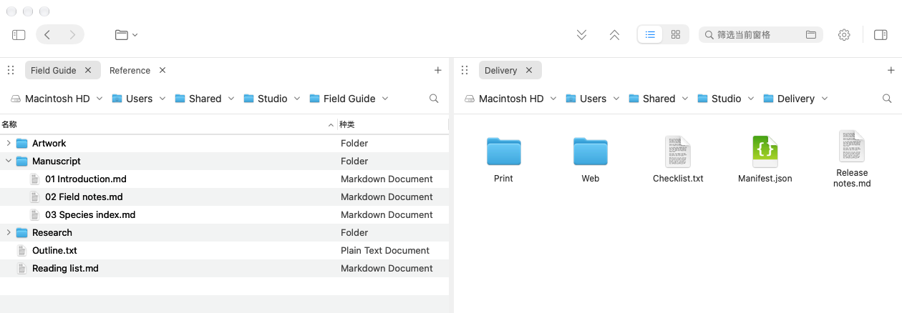

# Filetor Pro

[English](README.md) · **简体中文**

Filetor Pro 是一款原生 macOS 文件管理器，适合经常需要在多个文件夹之间整理资料的人。你可以把源文件和目标目录并排放，在列表里展开子文件夹，或按空格查看文件和 ZIP 压缩包里的内容。界面使用 SwiftUI 和 AppKit 构建。

**[下载 Apple 芯片版](https://github.com/Doithoo/Filetor-Pro/releases/latest)** · [版本记录](https://github.com/Doithoo/Filetor-Pro/releases) · [反馈问题](https://github.com/Doithoo/Filetor-Pro/issues)



## 安装与更新

发布版适用于搭载 **Apple 芯片**、运行 **macOS 26 或更高版本**的 Mac，目前不提供 Intel 安装包。应用界面和内置帮助均支持简体中文和英文。

1. 打开[最新版本](https://github.com/Doithoo/Filetor-Pro/releases/latest)，在 **Assets** 下下载 `Filetor-Pro-<版本号>-arm64.zip`。标为 *Source code* 的压缩包只有源码，不含可直接运行的应用。
2. 解压，把 **Filetor Pro.app** 拖入“应用程序”文件夹，再从那里打开。
3. 如果 macOS 阻止首次打开，请见[首次打开与文件夹权限](#首次打开与文件夹权限)。应用默认跟随系统语言；若要切换，进入**设置 → 通用 → 界面语言**，选择后退出并重新打开应用。

以后可从 **Filetor Pro → 检查更新…** 手动升级，也可在**设置 → 更新**中开启**自动检查并安装更新**。Sparkle 会验证更新清单和安装包的签名。自动更新在退出应用时安装，无需手动覆盖旧版。

## 从双窗格开始

| 想做什么 | 怎么操作 |
| --- | --- |
| 不离开当前位置，查看子文件夹 | 在**列表视图**中点击文件夹左侧的小三角。要展开当前窗格的目录树，选择**显示 → 展开所有文件夹**。 |
| 把另一个目录放在旁边 | 在文件区空白处点右键，选择**垂直分割（左右）**；想上下排列则选择**水平分割（上下）**。每个窗格都有独立标签页。 |
| 调整工作区布局 | 拖动标签栏最左侧的手柄，到另一窗格中央松开可交换位置，在边缘松开可移动到该侧。关闭某个窗格的最后一个标签页，即可关闭该窗格。 |
| 输入路径或查找文件 | 点击路径栏空白处即可编辑完整路径，按 Tab 补全。点击放大镜可按名称、类型、扩展名、日期和大小筛选，也可包含子文件夹。 |
| 不打开文件，先看内容 | 选中项目后按**空格**预览，再按一次关闭。如果想边浏览边看文件信息，点击工具栏最右侧的信息面板按钮。 |

每个窗口最多支持 16 个窗格。重新打开应用后，标签页、目录位置和窗格比例会恢复。按 **⌘N** 新建独立窗口，按 **⌘T** 在当前窗格添加标签页。

## 文件操作与格式支持

| 工具 | 能做什么 |
| --- | --- |
| 整理文件 | 通过右键菜单拷贝、剪切、粘贴、移动到指定目录、批量重命名或新建文本文件。侧栏可访问收藏夹、已挂载的磁盘、Finder 标签和废纸篓。 |
| 比较与同步 | 按相对路径、大小和修改时间比较可见的普通文件。先核对建议的拷贝方向，再执行同步；双向同步可一次撤销。隐藏文件、程序包内部和空文件夹不参与比较，也不会逐字节校验内容，如需确认备份内容完全一致，应另做内容校验。 |
| 预览 | 内置预览支持文件夹、ZIP 文件列表、常见文本与源代码、Markdown、JSON 和属性列表（plist）。图片、PDF 等受支持的媒体使用 macOS 系统快速查看。预览 ZIP 时只列出条目，无需解压。 |
| 压缩与解压 | 可创建 ZIP；可解压 ZIP、TAR、以 gzip、bzip2 或 xz 压缩的 TAR，以及单独的 gzip、bzip2 文件。遇到 7z、RAR、加密或分卷压缩包，请通过**打开方式**选择已安装的兼容应用，也可点“其他…”手动选择。 |

查找重复文件、保存搜索、转换图片等工具的用法，可在**帮助 → Filetor Pro 帮助**中查阅。使用指南和快捷键参考均可离线查看。

## 首次打开与文件夹权限

**macOS 提示无法打开应用。** 发布版使用维护者固定的代码签名证书，未使用 Apple Developer ID 签名，也未经 Apple 公证。如果确认安装包来自本仓库且信任它，请先尝试打开一次，再到**系统设置 → 隐私与安全性**查看“仍要打开”选项。无需关闭系统安全防护。

**废纸篓或受保护目录打不开。** 在 **Filetor Pro → 设置 → 文件夹访问权限**中点击**显示当前应用位置**，确认正在运行的是哪一份应用。如果该位置需要完全磁盘访问权限，请在**系统设置 → 隐私与安全性 → 完全磁盘访问权限**中添加这一份应用，然后退出并重新打开 Filetor Pro。授权由 macOS 管理。

文件操作在本机执行。检查更新会连接 GitHub，更新组件不上传文件内容，也不发送系统配置报告。选择“帮助 → 报告问题…”会打开一份可编辑的 GitHub 草稿，附上应用和 macOS 版本，由你决定是否提交。

## 从源码构建

在安装了 Python 3、Swift 工具链和兼容 macOS SDK 的 Mac 上运行：

```sh
git clone https://github.com/Doithoo/Filetor-Pro.git
cd Filetor-Pro
FILETOR_ADHOC_BUILD=1 python3 scripts/build.py
open ".build/pro/Filetor Pro.app"
```

首次构建会下载固定版本的 Sparkle 并校验完整性。上述命令对开发副本进行本地临时签名，不需要维护者的证书。开发副本与已安装的发布版共用偏好设置；若只想用临时测试文件运行回归检查，可执行 `python3 scripts/build.py --test`。

SDK 选择和 Xcode 操作请见[开发与验证指南](docs/DEVELOPMENT.md)；签名与发布步骤见[发布指南（英文）](docs/UPDATES.md)。

## 参与项目与许可证

欢迎在[本仓库的 Issues](https://github.com/Doithoo/Filetor-Pro/issues) 报告可复现的问题或提出功能建议。反馈问题时，请附上应用和 macOS 版本、复现步骤，以及你期望看到的结果。提交代码改动时，请以 **Doithoo/Filetor-Pro** 为目标仓库，并说明验证方式。

Filetor Pro 由 **Doithoo** 独立维护，基于 **David Praznik** 的 [Filetor](https://github.com/davidpraznik/Filetor) 开发，原应用图标也出自 David Praznik。项目采用 [MIT 许可证](LICENSE)；Sparkle 和可选的 libwebp 保留各自的许可证。
